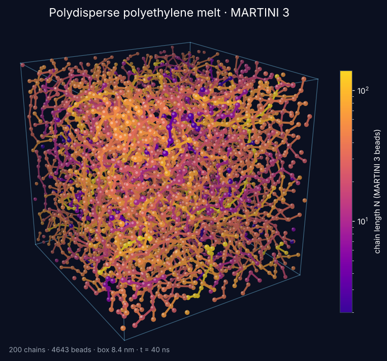
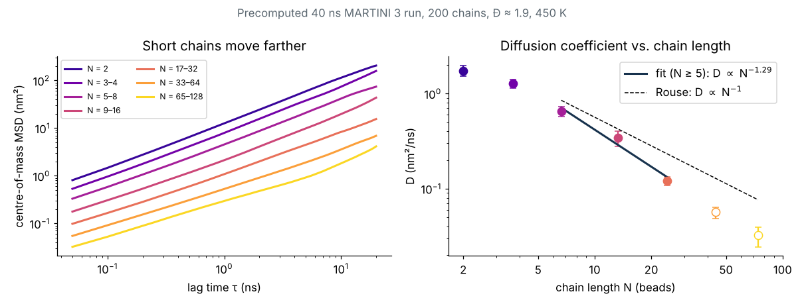

# PolyMelt · Hands-on Polymer Melts with G²RINS and MARTINI 3

A beginner-friendly Google Colab notebook that accompanies **Lecture 5 (Self-Assembly and Simulation)** of
**CHEM 73000 Polymer Chemistry (Part 2), CUNY**. Students build a polydisperse polyethylene sample with **G²RINS**
(from Dr. Gervasio Zaldivar's guest lecture), map it onto the **MARTINI 3** coarse-grained model, simulate it with **GROMACS**,
and then visualize the melt and measure how chain size and diffusion depend on chain length.

No installation or programming experience is needed: students run cells and change a few numbers.

## Open the notebook

[](https://colab.research.google.com/github/sloverde/PolyMelt/blob/main/Polyethylene_MARTINI3_G2RINS.ipynb)

Click the badge above. Or, in [Google Colab](https://colab.research.google.com), choose
**File → Open notebook → GitHub** and paste the address of this repository.
To keep your own copy, use **File → Save a copy in Drive**.



## What students do (about 45 minutes)

| Part | Activity | Course connection |
|---|---|---|
| 1 | Install GROMACS, G²RINS, MDAnalysis and py3Dmol (about 3 minutes) | |
| A | From atoms to beads: one all-atom C<sub>20</sub> chain with its five MARTINI 3 beads | Coarse-graining, Example 5.5 |
| B | Generate 200 chains from `{[] [<]CC[>]; [>][H]; [<][H] []}\|schulz_zimm(2400, 1200)\|`; plot M<sub>n</sub>, M<sub>w</sub> and Đ | Dr. Zaldivar's G²RINS lecture; molecular weight |
| C | Write the MARTINI 3 topology and pack the chains in a box | |
| D | Minimize → relax → equilibrate → 10 ns production at 450 K; check the density | Time steps, Example 5.5 |
| E | Spin the melt in 3D, highlight short and long chains, watch a movie, render a poster image | |
| F | Is the melt equilibrated? R<sub>g</sub><sup>2</sup>(N) from rod to coil, compared with an ideal freely rotating chain (no fitting); centre-of-mass MSD and its local slope; middle bead vs. whole chain (Rouse τ<sup>1/2</sup>); D(N) with bootstrap errors vs. the Rouse prediction D ∝ N<sup>−1</sup> | Chain statistics and dynamics |

Short on time? Set `use_precomputed = True` in Part D to analyze a **40 ns run of the same sample** that comes with this repository.



## Files

| File | Purpose |
|---|---|
| `Polyethylene_MARTINI3_G2RINS.ipynb` | The student notebook (2026) |
| `martini3/pe_tools.py` | Helper tools used by the notebook: G²RINS sampling, topology, packing, analysis and 3D views |
| `martini3/martini_v3.0.0_C1.itp` | MARTINI 3 force field, C1 bead only (excerpt of the official file, numbers unchanged) |
| `martini3/LICENSE-martini-forcefields.txt` | Apache 2.0 license of the MARTINI force-field files |
| `martini3/mdp/` | GROMACS run parameters: `em`, `npt_relax`, `npt_equil`, `md` |
| `martini3/precomputed/` | 40 ns run of the default sample: `start.gro`, topology, `md_nojump.xtc`, `sample.json` |
| `figures/` | Images on this page |
| `Polyethylene2_2023.ipynb` | Original all-atom notebook (see below) |
| `step3_input.gro`, `step4.*`, `step5_*`, `topol.top`, `toppar/`, `index.ndx` | All-atom C<sub>20</sub>H<sub>42</sub> melt from CHARMM-GUI (1,286 chains, 79,732 atoms) |

## The MARTINI 3 polyethylene model

Every bead is a MARTINI 3 **C1** bead standing for four CH<sub>2</sub> groups, as in the MARTINI 3 linear alkanes
(octane = 2 beads, dodecane = 3, hexadecane = 4). The same bonded parameters are used for chains of any length.
Chains shorter than about C<sub>10</sub> are given the smallest MARTINI 3 alkane, 2 beads. Chains are packed directly at melt
density as ideal random walks with the bending stiffness of the MARTINI 3 angle potential, so no compression step distorts them.

| Term | Parameters | Source |
|---|---|---|
| Non-bonded | C1–C1 Lennard-Jones, σ = 0.47 nm, ε = 3.39 kJ/mol | `martini_v3.0.0.itp` |
| Bonds | b<sub>0</sub> = 0.47 nm (0.475 nm for chain-end bonds), k<sub>b</sub> = 3800 kJ mol<sup>−1</sup> nm<sup>−2</sup> | MARTINI 3 alkanes (octane to hexadecane) |
| Angles | θ<sub>0</sub> = 180°, k<sub>θ</sub> = 35 kJ mol<sup>−1</sup> (GROMACS angle type 2) | MARTINI 3 alkanes |
| Run settings | reaction field (ε<sub>r</sub> = 15), 1.1 nm cut-offs, 20 fs time step, v-rescale 450 K, C-rescale 1 bar | MARTINI 3 recommended settings |

## The original all-atom notebook

[](https://colab.research.google.com/github/sloverde/PolyMelt/blob/main/Polyethylene2_2023.ipynb)

`Polyethylene2_2023.ipynb` runs the all-atom C<sub>20</sub>H<sub>42</sub> melt (CHARMM general force field, set up with CHARMM-GUI).
Compare its 2 fs time step and 79,732 atoms with the 20 fs step and about 4,600 beads of the MARTINI 3 model.

## Running outside Colab

You need GROMACS 2021 or newer (`gmx` on your PATH) and Python with

```
pip install "g2rins @ git+https://github.com/depablolab/g2rins.git@v1.0.0" MDAnalysis py3Dmol jupyter
```

then open the notebook in Jupyter from the top folder of this repository.

## Credits

* **G²RINS** (v1.0.0) by the de Pablo group: <https://github.com/depablolab/g2rins> (GPL-3.0).
  Paper: G. Zaldivar, Y. Tian, G. Sun, C. Kappatou, P. Eiden, N. B. Wulkow, V. Settels, J. J. de Pablo,
  *G2RINS: A Generative String-and-Graph Polymer Representation to Assist Computational Materials Discovery*,
  ChemRxiv (2026). [doi:10.26434/chemrxiv.15007504/v1](https://doi.org/10.26434/chemrxiv.15007504/v1)
  Guest-lecture hands-on: <https://github.com/sloverde/CHEM73000-G2RINS-HandsOn>.
* **MARTINI 3**: P. C. T. Souza *et al.*, *Nat. Methods* **18**, 382–388 (2021),
  [doi:10.1038/s41592-021-01098-3](https://doi.org/10.1038/s41592-021-01098-3).
  Force-field file from <https://github.com/marrink-lab/martini-forcefields> (Apache-2.0).
* **GROMACS** (<https://www.gromacs.org>), **MDAnalysis** (<https://www.mdanalysis.org>), **py3Dmol** (<https://3dmol.org>),
  **CHARMM-GUI** (<https://www.charmm-gui.org>).
* Notebook developed by Prof. Sharon Loverde (College of Staten Island / CUNY Graduate Center).
